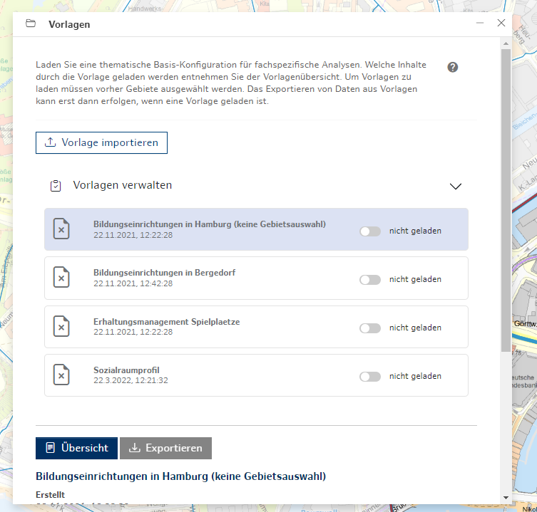
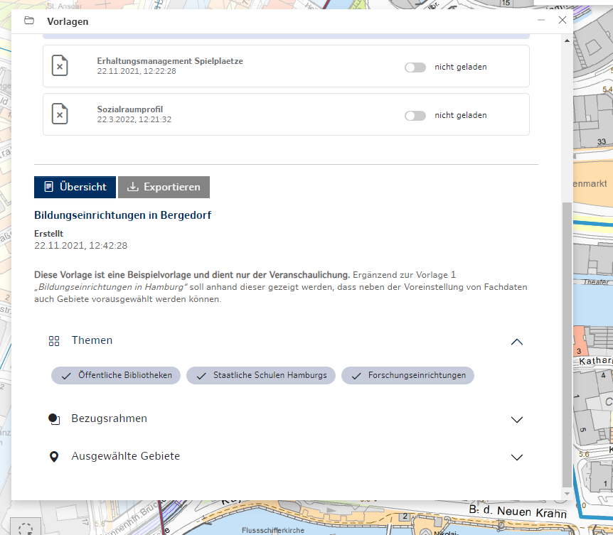
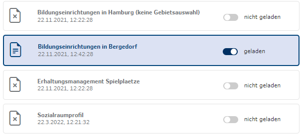
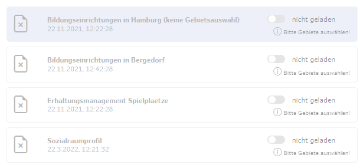
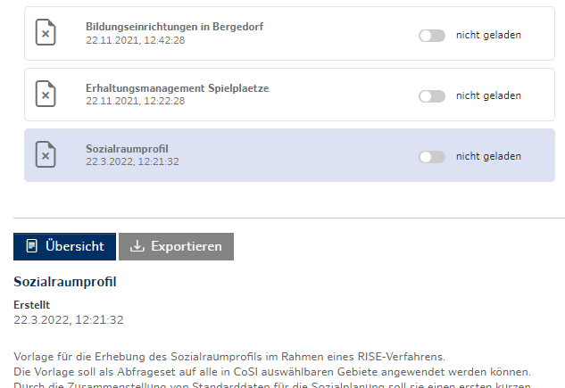
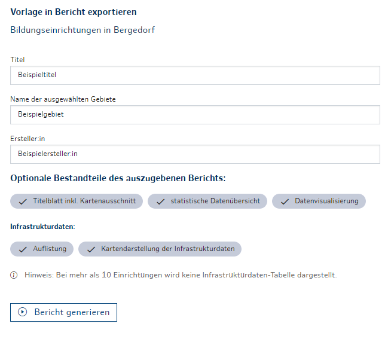
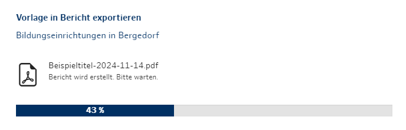

### Vorlagen

*Abb. a: Vorlagenverwaltung*

*Abb. b: Inhalte der selektierten Vorlage*

Über das Tool **Vorlagen** können Vorlagen zu verschieden Themenkomplexen und Arbeitsfeldern geladen werden. Diese können Fachdatenthemen, aktive Werkzeuge und eine Gebietsauswahl beinhalten. Die verfügbaren Vorlagen und ihr Inhalt werden von den Fachbehörden in Koordination mit dem CoSI-Betriebsteam gepflegt. Außerdem können Daten geladener Vorlagen als PDF exportiert werden.

   Bevor eine Vorlage geladen werden kann müssen Sie über die Gebietsauswahl Gebiete auswählen, sofern Ihre Vorlage keine eigene Gebietsauswahl enthält. Wenn das entsprechende Gebiet ausgewählt ist, finden Sie unter Dienste die Option Vorlagen. Hier können Sie nun alle weiteren Optionen für die Vorlagen auswählen.

   Hinweis: Enthält die Vorlage eine Gebietsauswahl, werden die im Vorfeld ausgewählten Gebiete nicht berücksichtigt.

1. **Vorlagen verwalten**

   Die Vorlagen können per Klick ausgewählt werden und sind dann blau eingefärbt. Unterhalb dieses Abschnitts werden die Inhalte der Vorlagen angezeigt. Wird der Switch aktiviert, so ändert sich das Label in "geladen" und die Vorlage wird geladen. Es kann immer nur eine Vorlage geladen werden.

   

   *Abb. c: Geladene Vorlage "Bildungseinrichtungen in Bergedorf".*

   Der Hinweis "Bitte Gebiete auswählen!" zeigt an, dass Sie keine Gebiete ausgewählt haben und auch die entsprechende Vorlage keine Gebiete enthält. Es ist in diesem Fall nicht möglich eine Vorlage zu laden.

   

    *Abb. d: Ansicht, wenn keine Gebiete ausgewählt wurden und keine Gebiete in den Vorlagen enthalten sind.*

   Liste aller Vorlagen:
   - Bildungseinrichtungen in Hamburg
   - Bildungseinrichtungen in Bergedorf
   - Erhaltungsmanagement Spielplätze
   - Sozialraumprofil

   Eigene Vorlagen können über den Button "Vorlage importieren" hochgeladen werden und erscheinen ebenfalls im Abschnitt "Vorlagen verwalten".

2. **Vorlagen: Übersicht**

    Unter "Übersicht" werden alle Inhalte der ausgewählten Vorlage angezeigt. Per Klick auf die Tags können Inhalte der Vorlage an- oder abgewählt und so individuell angepasst werden.

   Hinweis: Die Inhalte einer Vorlage können nicht bearbeitet werden, während sie geladen sind. Haben Sie eine Vorlage geladen und wollen anschließend die Vorlage noch einmal ändern, müssen Sie die Vorlage mit dem Switch auf "nicht geladen" setzen, Ihre Änderungen vornehmen und anschließend erneut laden.

   Vorlagen können aus folgenden Inhalten bestehen:
   - Titel
   - Stand (Datum)
   - Beschreibung
   - Fachdatenthemen
   - Aktiver Bezugsrahmen (Verwaltungsebene)
   - Statistische Daten
   - Ausgewählte Gebiete
   - Berechnungen
   - Ausgewähltes Werkzeug

3. **Vorlagen: Exportieren**

   Die Daten einer Vorlage können erst exportiert werden, wenn die Vorlage geladen ist. Ist die Vorlage nur selektiert, ist der Button "Exportieren" ausgegraut.

   

   *Abb. e: Vorlage ist nicht geladen und kann daher nicht exportiert werden.*

   Wenn Sie eine Vorlage geladen haben und in die "Exportieren"-Ansicht gewechselt sind, kann ein PDF-Bericht generiert werden, der anschließend heruntergeladen wird.
   Folgende Elemente können Sie mithilfe des Formulars im PDF anpassen:

   - Titel
        - erscheint in der Kopfzeile und als Überschrift
        - wird kein Titel eingegeben wird "Übersichtskarte" als Titel gesetzt.
        - aus Layout-Gründen besteht eine Zeichenbegrenzung
   - Name der ausgewählten Gebiete
        - erscheint in der zweiten Spalte der Tabelle zur statistischen Datenübersicht
        - aus Layout-Gründen besteht eine Zeichenbegrenzung
   - Ersteller:in
        - erscheint in der Fußzeile

   Folgende Bestandteile des PDF-Berichts können hinzugefügt oder entfernt werden:
        - Titelblatt inklusive Kartenausschnitt
        - statistische Datenübersicht
        - Datenvisualisierung
        - Auflistung (der Infrastrukturdaten)
        - Kartendarstellung der Infratsrukturdaten

   

   *Abb. f: Aufbau des Export-Formulars*

   Mit einem Klick auf "Bericht generieren" startet der Export-Prozess. Ein Ladebalken zeigt an, wie weit die Generierung des Berichts fortgeschritten ist. Anschließend startet ein automatischer Download und der PDF-Bericht kann im "Speichern unter"-Dialog des Browsers auf dem Computer abgespeichert werden. Wenn Sie eine neue Vorlage laden oder einen neuen Exportprozess starten möchten, können Sie mit dem Button "Zurück zur Vorlage" zur Vorlagenverwaltung zurückkehren.

   

   *Abb. g: Generierung des Berichts mit Fortschrittsanzeige*

   

   *Abb. h: Der Bericht wurde erfolgreich erstellt.*

