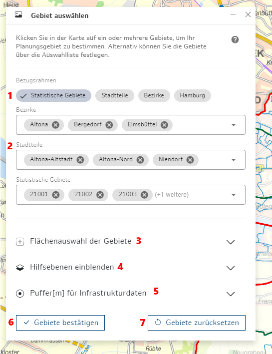

## Gebietsauswahl
___
Als erster Arbeitsschritt in CoSI muss grundsätzlich eine Gebietsauswahl für das zu betrachtende Planungsgebiet getroffen werden.  Die Gebietsauswahl können sie entweder im Bezugsrahmen der Bezirke, der Stadtteile oder der statistischen Gebiete treffen.

Wenn Sie Ihre Gebietsauswahl später ändern möchten, können Sie dies unter Gebiete auswählen tun.

*Abb. a: Das Werkzeug Gebiet auswählen.*

1. **Bezugsrahmen wählen**

   Mithilfe der Tags kann **Hamburg**, **Bezirke**, **Stadtteile** oder **Statistische Gebiete** ausgewählt werden – dies legt die Verwaltungseinheit fest, für die die statistischen Daten angezeigt und Auswertungen erstellt werden sollen. Alle Funktionen sind auf dem jeweiligen Bezugsrahmen verfügbar. Die Zahl der verfügbaren Indikatoren kann jedoch variieren. Der Bezugsrahmen bestimmt auch die zu ladenden übergeordneten Referenzgebiete: Stadtteile für stat. Gebiete, Bezirke für Stadtteile.
2. **Gebiete aus- und abwählen**

    - Karte:
        - die einzelnen Gebiete anklicken (nochmaliges Klicken deaktiviert die Auswahl wieder), die Grenzen werden blau markiert.
        - ausgewählte Gebiete erscheinen im "Gebiete auswählen" -Tool in den zugehörigen Dropdown
    - Tool:
        - Wird ein Bezugsrahmen ausgewählt, zum Beispiel "Statistische Gebiete", erscheinen zusätzlich alle übergeordneten Bezugsebenen in Dropdowns (in diesem Fall "Stadtteile", "Bezirke").
        - Jedes Dropdown filtert die untergeordneten Ebenen. Wählt man beispielsweise Altona als Bezirk, werden in den Dropdowns alle Stadtteile und alle statistischen Gebiete in Altona angezeigt.
        - Die unterste Ebene enthält immer die Möglichkeit alle Gebiete zeitgleich aus- und abzuwählen.
        - Auf der untersten Ebene können direkt Gebiete ausgewählt werden ohne vorher in Stadtteilen oder Bezirken zu filtern.
3. **Flächenauswahl der Gebiete**

   Mit dem Klick auf das Icon wird das Zeichentool aktiviert. Damit können Nutzer:innen ein Rechteck über das gewünschte Gebiet ziehen, um dieses auszuwählen. Ausgewählte Gebiete erscheinen in den Gebiete-Dropdowns.
   Ein Startpunkt wird gesetzt und ein Rechteck bis zum Endpunkt über das relevante Gebiet gezogen. Alle Gebiete, die innerhalb des Rechtecks liegen oder das Rechteck schneiden, werden in das Planungsgebiet aufgenommen.

4. **Hilfsebenen einblenden**

   Mithilfe der Switches können zusätzliche Layer zur Orientierung ein- und ausgeblendet werden. Der Layer kann ebenfalls über den Themenbaum ein- und ausgeschaltet werden. Zu den Hilfsebenen gehören aktuell die "Sozialräume" und die "RISE Fördergebiete".

5. **Puffer für Infrastrukturdaten**

   Es kann ein Puffer in Metern festgelegt werden. Für den werden ausgewählte Fachdaten um das Planungsgebiet herum angezeigt. Dies berücksichtigt die Tatsache, dass das Einzugsgebiet von einer Einrichtung nicht unbedingt übereinstimmt mit den Gebietsgrenzen der Verwaltungseinheit innerhalb derer sich die Einrichtung befindet. Die Analysefunktionen werden davon nicht beeinflusst.

6. **Gebiet bestätigen**

   Lädt die Daten für das ausgewählte Planungsgebiet und legt den Bereich für die anzuzeigenden Fachdaten fest. Auch eine leere Auswahl kann bestätigt werden. Dann werden keine bevölkerungsstatistischen Daten geladen und Fachdaten für den gesamten Stadtbereich angezeigt. (s. unten).

7. **Gebiet zurücksetzen**

   Setzt das aktuelle Planungsgebiet zurück. Im direkten Anschluss kann ein neues Planungsgebiet zusammengestellt und bestätigt werden.

Das festgelegte Planungsgebiet kann jederzeit angepasst werden:

   - Das Gebiet kann *erweitert* werden: sowohl per Klick als auch per Zeichentool.
   - Das Gebiet kann *verkleinert* werden: per Klick können markierte Verwaltungseinheiten wieder abgewählt werden.
   - Das Gebiet kann komplett zurückgesetzt werden: per Klick auf "Auswahl zurücksetzen".

Es muss nicht in jedem Nutzungskontext immer ein Planungsgebiet als erstes festgelegt werden; bestimmte Analysetools wie z.B. die [Erreichbarkeitsanalyse](./003erreichbarkeitsanalyse.md) und [Vergleichbare Gebiete](./004vergleichbaregebieteermitteln.md) können verwendet werden ohne dass vorher ein Gebiet festgelegt wird.

Für solche Fälle gelten folgende Hinweise:

   - Es werden keine Datensätze geladen, d.h. eine Anzeige der regionalstatistischen Daten ist nicht möglich. Auch werden keine regionalstatistischen Daten im Dashboard angezeigt.
   - Beim Zuschalten von Themen aus den Fachdaten könnte der Ladevorgang länger dauern.
   - Möglicherweise funktioniert die [Erreichbarkeitsanalyse](./003erreichbarkeitsanalyse.md) für eine sehr große Zahl von Einrichtungen nicht zuverlässig.
