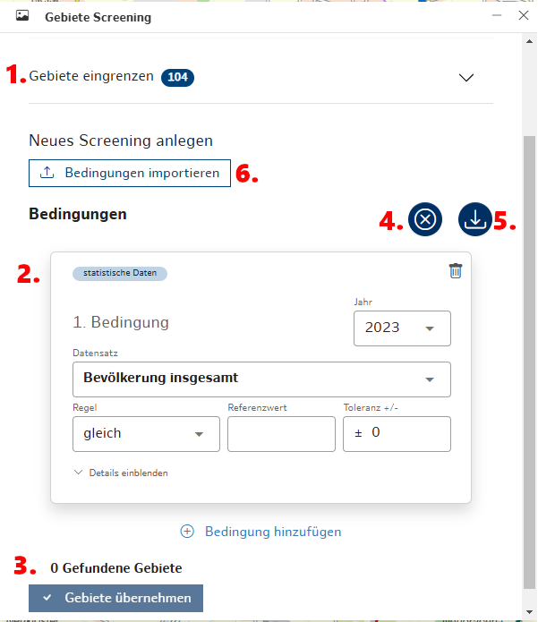
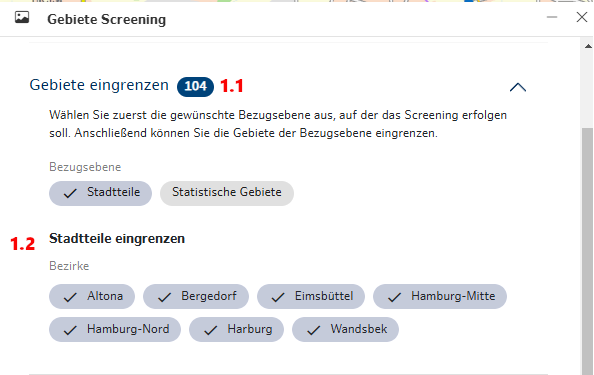
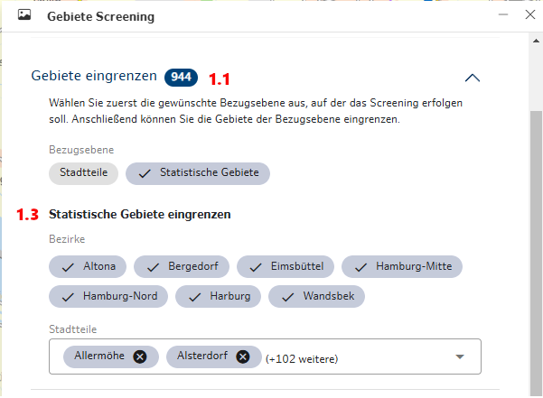
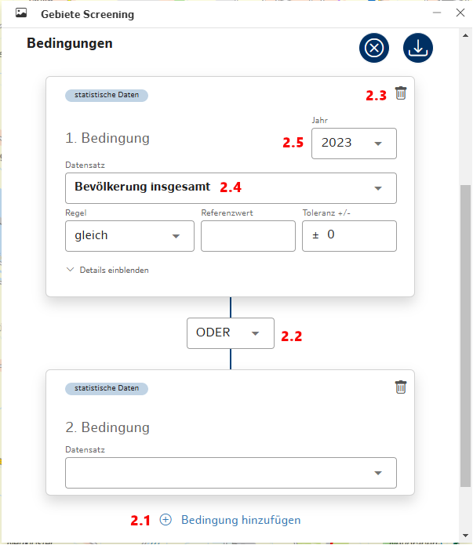
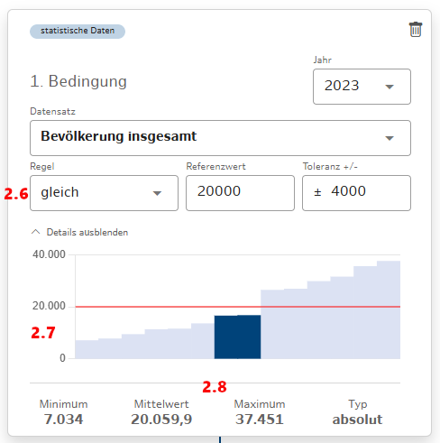
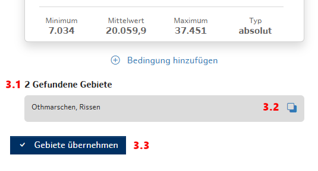
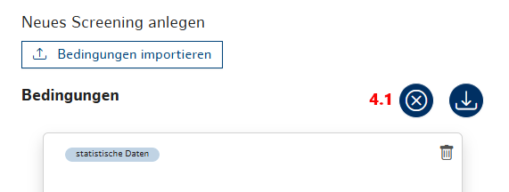
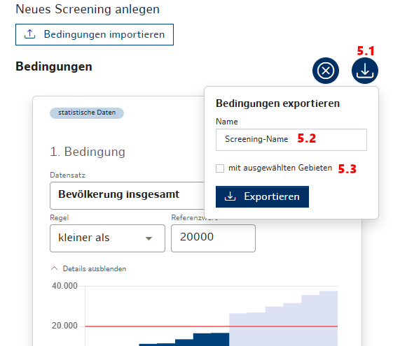
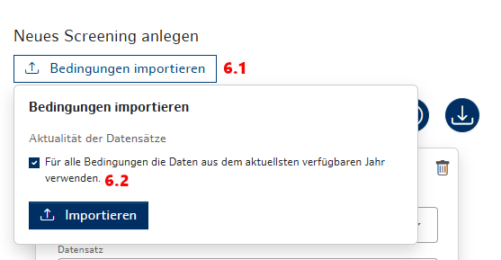

### Gebiete Screening
Mit dem Tool **Gebiete Screening** können verschiedene Bedingungen definiert und erstellt werden, um darauf basierend statistische Gebiete oder Stadtteile zu screenen und für die weitere Arbeit auszuwählen.

*Abb. a: Toolübersicht*

1. **Gebiete eingrenzen**
   Sobald das Tool geöffnet wird, sind alle Gebiete einer Bezugsebene bereits ausgewählt. Im Bereich "Gebiete eingrenzen" können die Gebiete, auf die das Screening angewendet werden soll, genauer festgelegt werden. Das blaue Badge gibt an, wieviele Gebiete momentan ausgewählt sind (1.1).

   Auf der Bezugsebene "Stadtteile" können alle Stadtteile ausgewählter Bezirke ausgewählt werden (1.2).

   
   *Abb. b: Stadtteile eingrenzen*

   Auf der Bezugsebene "Statistische Gebiete" können alle statistischen Gebiete nach Bezirken und Stadtteilen ausgewählt werden (1.3).
    
    *Abb. c: Statistische Gebiete eingrenzen*

2. **Bedingungen hinzufügen**
    Für das Screening können mehrere Bedingungen erstellt werden (2.1), die mit einer Verknüpfung (UND, ODER) miteinander verbunden sind (2.2). Die Anzahl der Bedingungen ist nicht eingeschränkt. Außerdem können einzelne Bedingungskarten auch wieder gelöscht werden (2.3).
    In jeder Bedingungskarte muss ein Datensatz ausgewählt werden (2.4). Anschließend ist es möglich ein vorhandenes Jahr auszuwählen (2.5). Mithilfe einer Regel (gleich, größer als, kleiner als) und einem Referenzwert können entsprechende Gebiete gefiltert werden. Für die Regel "gleich" gibt es zusätzlich noch die Möglichkeit eine Toleranz festzulegen (2.6).
    Das Diagramm enthält alle zuvor eingegrenzten Gebiete (2.7), wobei der Referenzwert als rote Linie dargestellt wird. Gebiete, die der Bedingung entsprechen, werden farblich hervorgehoben.
    Am Ende jeder Bedingungskarte werden Minimum, Maximum, Mittelwert und Typ des ausgewählten Datensatzes angezeigt, um einen besseren Überblick über die Daten zu bekommen (2.8).

    
    *Abb. d: Bedingungskarten*

    
    *Abb. e: Aufbau einer Bedingungskarte*

3. **Gefundene Gebiete**

   Die Anzahl aller gefundenen Gebiete, auf die die Bedingungen zutreffen, wird unter den Bedingungskarten angezeigt (3.1). Weiterhin können die gefunden Gebiete kopiert (3.2) oder für die weitere Arbeit übernommen (3.3) werden.

   
   *Abb. f: Gefundene Gebiete*

4. **Bedingungen zurücksetzen**

    Mit einem Klick auf den Reset-Button (4.1) werden alle angelegten Bedingungen und ihre jeweiligen Verknüpfungen gelöscht werden. Anschließend ist es möglich wieder neue Bedingungen hinzuzufügen.

    

   *Abb. g: Alle Bedingungen zurücksetzen.*

5. **Bedingungen exportieren**

    Alle Bedingungen inklusive ihrer Verknüpfungen können exportiert (5.1) und später wieder importiert werden. Im Dropdown gibt es die Möglichkeit einen Namen für das komplette Screening anzulegen (5.2.). Außerdem kann das Screening mit allen ausgewählten Gebieten (1.)exportiert werden (5.3).

    

   *Abb. h: Screening exportieren*

6. **Bedingungen importieren**

    Mit einem Klick auf "Bedingungen importieren" können Screenings imnportiert werden (6.1). Alle Bedingungen werden mit den jeweils ausgewählten Jahren exportiert. Es besteht allerdings die Möglichkeit nach neueren Datensätzen zu suchen und für alle Bedingungen den aktuellsten verfügbaren Datensatz beim Import auszuwählen (6.2). Wird ein neuerer Datensatz gefunden, erhält der User einen entsprechenden Hinweis. Beim Import wird der Name des Screening und das Datum, an dem der Export durchgeführt wurde, angezeigt.

    

   *Abb. i: Screening importieren*
